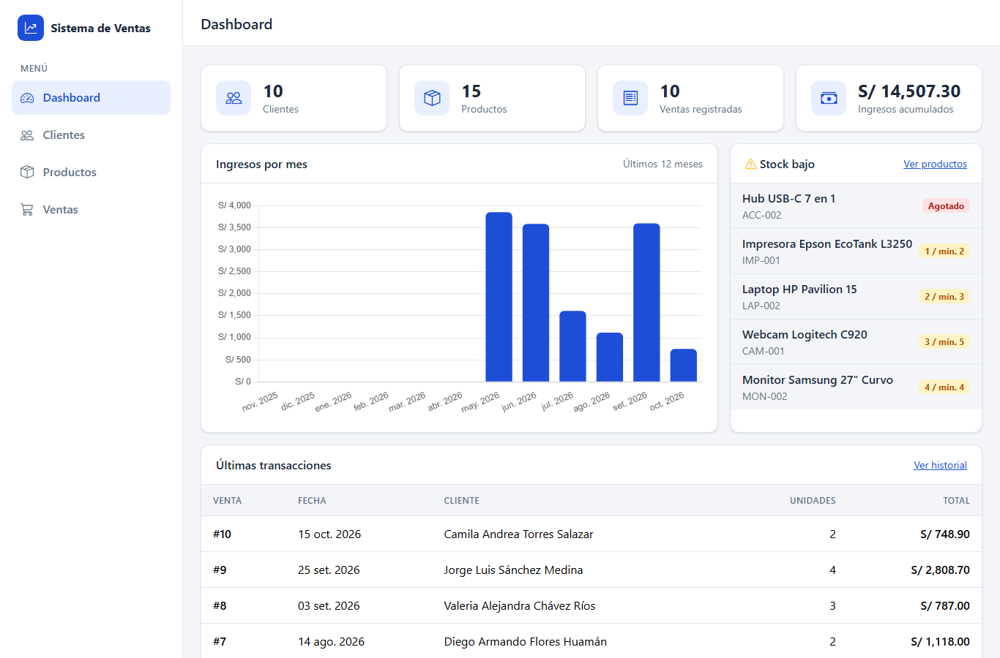
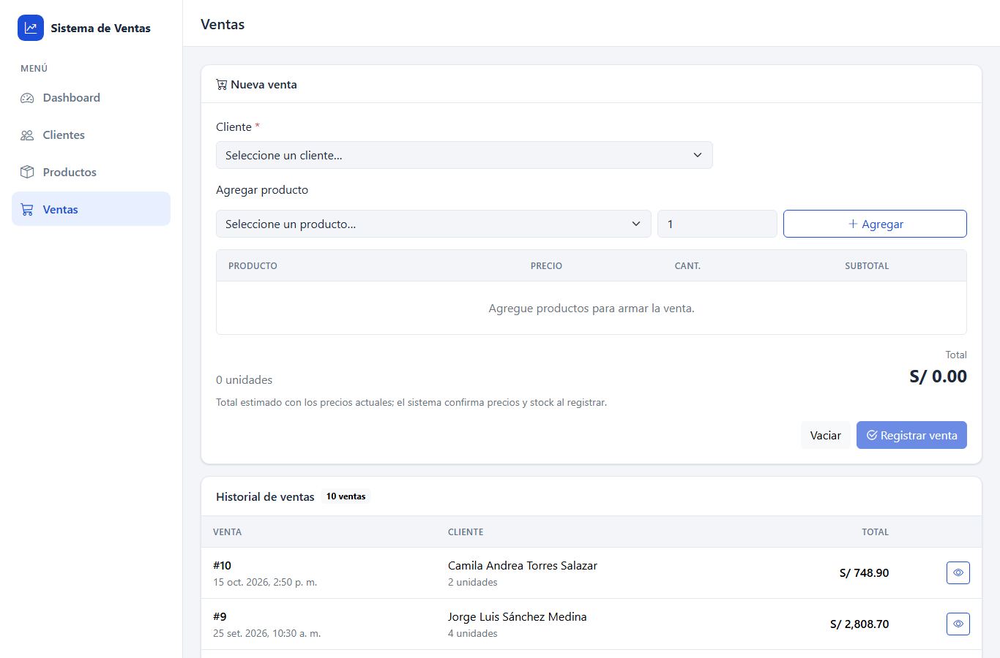
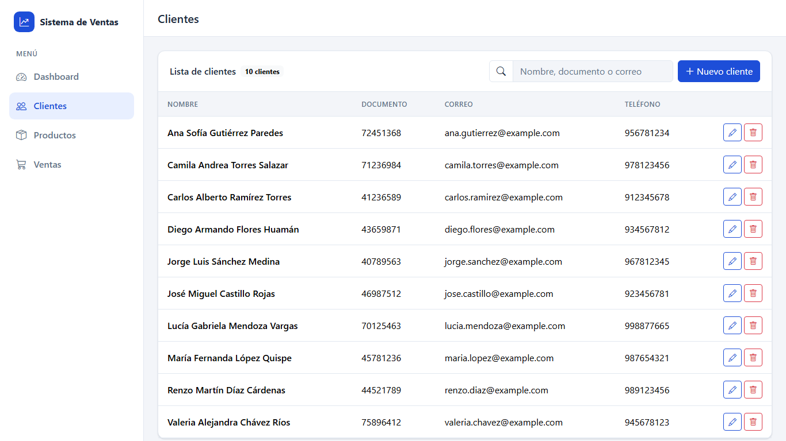
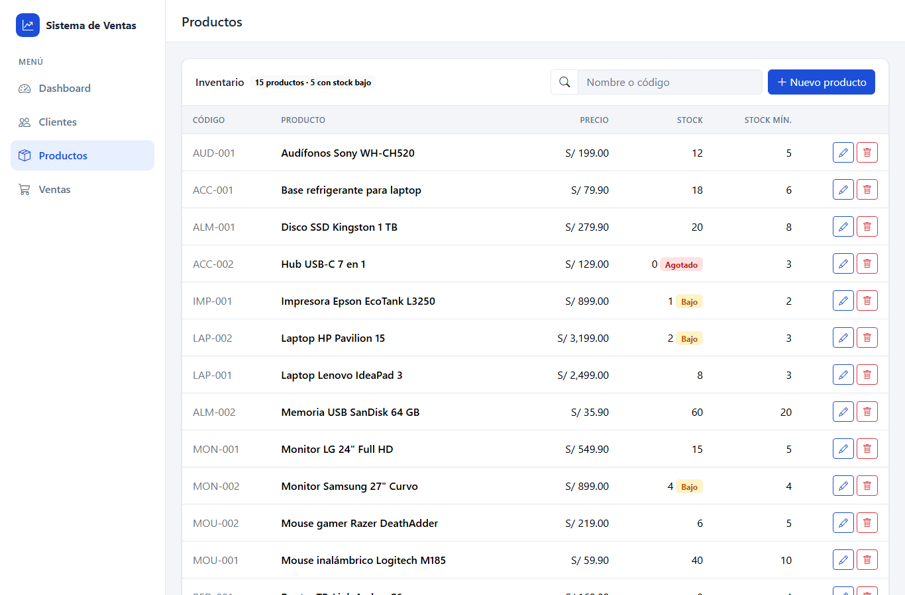

# Sistema de Ventas y Gestión de Clientes

Aplicación web full stack para registrar clientes, administrar un inventario de productos y registrar ventas con control de stock. El backend es una API REST en **ASP.NET Core (.NET 10)** con **Entity Framework Core** y **SQL Server**; el frontend usa **HTML, CSS, JavaScript y Bootstrap 5**, sin frameworks SPA.


## Funcionalidades

- **Dashboard:** total de clientes, productos, ventas e ingresos; gráfico de ingresos de los últimos 12 meses; últimas transacciones y productos con stock bajo.
- **Clientes:** alta, edición, eliminación y búsqueda por nombre, documento o correo. El correo y el documento son únicos y no se puede eliminar un cliente con ventas.
- **Productos:** alta, edición, eliminación y búsqueda por nombre o código. Alerta de stock bajo cuando `stock <= stock mínimo`, y no se puede eliminar un producto que ya se vendió.
- **Ventas:** carrito con varios productos y cálculo del total en vivo. El backend vuelve a calcular precios y total, valida el stock y registra la venta con su detalle y el descuento de stock en **una sola transacción**. Incluye historial y detalle de cada venta.

## Capturas

| Dashboard | Ventas |
|---|---|
|  |  |

| Clientes | Productos |
|---|---|
|  |  |

La interfaz es responsive desde 375 px: en pantallas pequeñas la barra lateral se convierte en un menú desplegable.

## Tecnologías

| Capa | Tecnología |
|---|---|
| Backend | C# · ASP.NET Core Web API (.NET 10) con controladores |
| Acceso a datos | Entity Framework Core 10, Code First con migraciones |
| Base de datos | SQL Server LocalDB (`VentasDB`) |
| Documentación de la API | Swagger (Swashbuckle) en desarrollo |
| Frontend | HTML5 · CSS3 · JavaScript (módulos ES, `fetch`) · Bootstrap 5.3 · Bootstrap Icons · Chart.js 4 |
| Control de versiones | Git |

## Arquitectura

```
┌──────────────────────────┐   fetch (JSON)   ┌──────────────────────────────────────────────┐    EF Core    ┌─────────────────────┐
│ frontend/                │ ───────────────► │ backend/  ASP.NET Core Web API               │ ────────────► │ SQL Server LocalDB  │
│ HTML + Bootstrap + JS    │   CORS limitado  │ Controllers → Services → DbContext           │  migraciones  │ VentasDB            │
│ http://127.0.0.1:5500    │ ◄─────────────── │ Manejador global de errores (ProblemDetails) │               │                     │
└──────────────────────────┘                  └──────────────────────────────────────────────┘               └─────────────────────┘
```

- **Controllers:** solo manejan HTTP: reciben DTOs y devuelven `200`, `201` con `Location` o `204`.
- **Services:** contienen las reglas de negocio (unicidad, borrado protegido, cálculo de totales, transacción de venta).
- **DTOs:** separan el contrato de la API de las entidades. La venta no recibe precios ni total: el backend los calcula.
- **Manejo de errores:** los servicios lanzan excepciones de negocio y un `IExceptionHandler` las traduce a `ProblemDetails` (RFC 9457) con `400`, `404`, `409` o `500`.

```
sistema-ventas/
├── backend/
│   ├── SistemaVentas.slnx
│   └── SistemaVentas.Api/
│       ├── Controllers/        # Clientes, Productos, Ventas, Dashboard
│       ├── DTOs/               # Contratos de entrada/salida con Data Annotations
│       ├── Data/
│       │   ├── Configurations/ # Fluent API: decimal(18,2), índices únicos, CHECK, FK
│       │   ├── SeedData.cs     # Datos de ejemplo
│       │   └── VentasDbContext.cs
│       ├── Errors/             # Excepciones de negocio y manejador global
│       ├── Migrations/
│       ├── Models/             # Entidades: Cliente, Producto, Venta, DetalleVenta
│       ├── Services/           # Reglas de negocio
│       └── Program.cs
├── frontend/
│   ├── index.html · clientes.html · productos.html · ventas.html
│   ├── css/styles.css          # Paleta en variables CSS y layout
│   └── js/
│       ├── api.js              # Wrapper de fetch que traduce ProblemDetails a errores
│       ├── ui.js               # Barra lateral, toasts, confirmación, formularios, formatos
│       └── dashboard.js · clientes.js · productos.js · ventas.js
└── docs/capturas/
```

### Modelo de datos

| Tabla | Campos principales | Restricciones |
|---|---|---|
| `Clientes` | Nombre, Documento, Correo, Telefono, Direccion, FechaRegistro | Correo y Documento únicos |
| `Productos` | Codigo, Nombre, Descripcion, Precio, Stock, StockMinimo | Código único · `Precio > 0` · `Stock >= 0` |
| `Ventas` | ClienteId, Fecha, Total | FK a Clientes con `Restrict` · índice por Fecha |
| `DetalleVentas` | VentaId, ProductoId, Cantidad, PrecioUnitario, Subtotal | FK a Productos con `Restrict` · `Subtotal = Cantidad × PrecioUnitario` |

Los montos son `decimal(18,2)`. `DetalleVentas.PrecioUnitario` guarda el precio vigente al momento de la venta, así que cambiar el precio de un producto no altera el historial.

## Decisiones técnicas destacadas

- **Venta transaccional y segura ante concurrencia.** El stock se descuenta con un `UPDATE ... WHERE Stock >= @cantidad` atómico dentro de la transacción. Si dos ventas compiten por la última unidad, solo una se registra y la otra se revierte por completo. Las líneas se procesan ordenadas por producto para evitar deadlocks.
- **El backend es la fuente de verdad.** El frontend muestra un total estimado (calculado en céntimos enteros para evitar errores de coma flotante), pero solo envía cliente, productos y cantidades.
- **Validación en dos capas.** Data Annotations en la API y las mismas reglas en HTML5 (`required`, `pattern`, `min`, `step`) en los formularios. Los errores `400` del servidor se muestran debajo de cada campo.
- **Seguridad.** No hay secretos versionados: la cadena de conexión usa autenticación integrada de Windows. CORS solo permite el origen local del frontend en desarrollo, todo texto de la API se escapa antes de insertarse en el HTML, y las librerías del CDN se cargan con *Subresource Integrity*.

## Requisitos

- Windows con [SDK de .NET 10](https://dotnet.microsoft.com/download/dotnet/10.0)
- SQL Server **LocalDB** (se instala con Visual Studio o con el instalador de SQL Server Express)
- Herramienta de EF Core:
  ```powershell
  dotnet tool install --global dotnet-ef --version 10.*
  ```
- Para servir el frontend: la extensión **Live Server** de VS Code, o Python 3

## Instalación

1. Clona el repositorio:
   ```powershell
   git clone https://github.com/adriaaanzd/sistema-ventas.git
   cd sistema-ventas
   ```
2. Confía en el certificado HTTPS de desarrollo (una sola vez; abre un diálogo de Windows):
   ```powershell
   dotnet dev-certs https --trust
   ```
3. Crea la base de datos `VentasDB` con sus datos de ejemplo:
   ```powershell
   cd backend\SistemaVentas.Api
   dotnet ef database update
   ```
   La migración crea las 4 tablas e inserta 10 clientes, 15 productos (5 con stock bajo) y 10 ventas entre mayo y octubre de 2026.

## Ejecución

1. **API** (desde `backend\SistemaVentas.Api`):
   ```powershell
   dotnet run --launch-profile https
   ```
   - API: `https://localhost:7080/api`
   - Swagger: `https://localhost:7080/swagger`

2. **Frontend**, servido en `http://127.0.0.1:5500` (es el origen permitido por CORS):
   - **VS Code:** clic derecho en `frontend/index.html` → *Open with Live Server*.
   - **Python:** desde la raíz del repositorio:
     ```powershell
     python -m http.server 5500 --bind 127.0.0.1 --directory frontend
     ```
   Abre `http://127.0.0.1:5500/index.html`.

## Endpoints

| Método | Ruta | Descripción | Respuestas |
|---|---|---|---|
| GET | `/api/clientes?buscar=` | Lista o busca clientes por nombre, documento o correo | 200 |
| GET | `/api/clientes/{id}` | Obtiene un cliente | 200, 404 |
| POST | `/api/clientes` | Crea un cliente | 201, 400, 409 |
| PUT | `/api/clientes/{id}` | Actualiza un cliente | 204, 400, 404, 409 |
| DELETE | `/api/clientes/{id}` | Elimina un cliente sin ventas | 204, 404, 409 |
| GET | `/api/productos?buscar=` | Lista o busca productos por nombre o código | 200 |
| GET | `/api/productos/{id}` | Obtiene un producto | 200, 404 |
| POST | `/api/productos` | Crea un producto | 201, 400, 409 |
| PUT | `/api/productos/{id}` | Actualiza un producto | 204, 400, 404, 409 |
| DELETE | `/api/productos/{id}` | Elimina un producto que no aparece en ventas | 204, 404, 409 |
| GET | `/api/ventas` | Historial de ventas (más reciente primero) | 200 |
| GET | `/api/ventas/{id}` | Detalle de una venta con sus líneas | 200, 404 |
| POST | `/api/ventas` | Registra una venta (transacción) | 201, 400 |
| GET | `/api/dashboard` | Indicadores, ventas por mes, últimas ventas y stock bajo | 200 |

Ejemplo de registro de venta:

```http
POST /api/ventas
Content-Type: application/json

{
  "clienteId": 2,
  "lineas": [
    { "productoId": 5, "cantidad": 1 },
    { "productoId": 11, "cantidad": 3 }
  ]
}
```

Ejemplo de error (`400`, formato ProblemDetails):

```json
{
  "type": "https://tools.ietf.org/html/rfc9110#section-15.5.1",
  "title": "Regla de negocio no cumplida",
  "status": 400,
  "detail": "Stock insuficiente: Webcam Logitech C920 (disponible: 3, solicitado: 10)."
}
```

## Autor

**Adrian Castillo** · [github.com/adriaaanzd](https://github.com/adriaaanzd)
